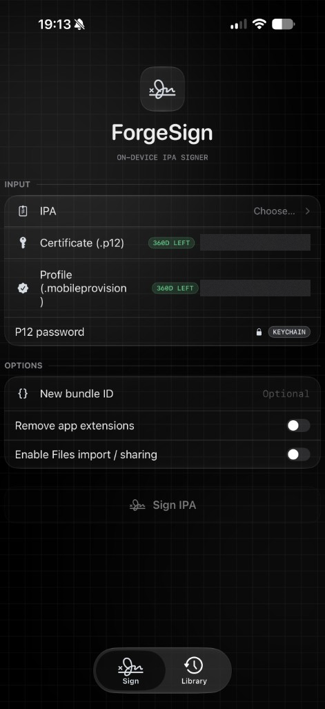
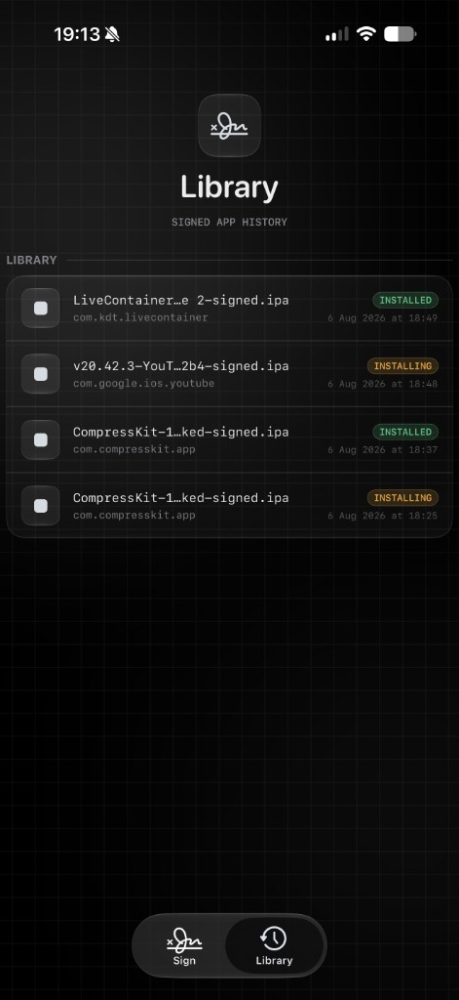
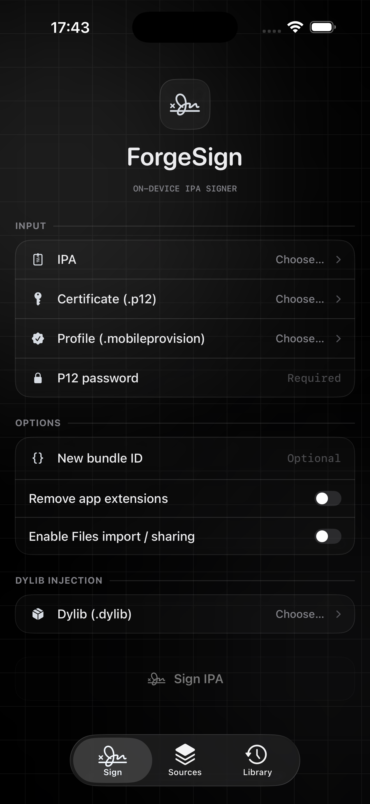
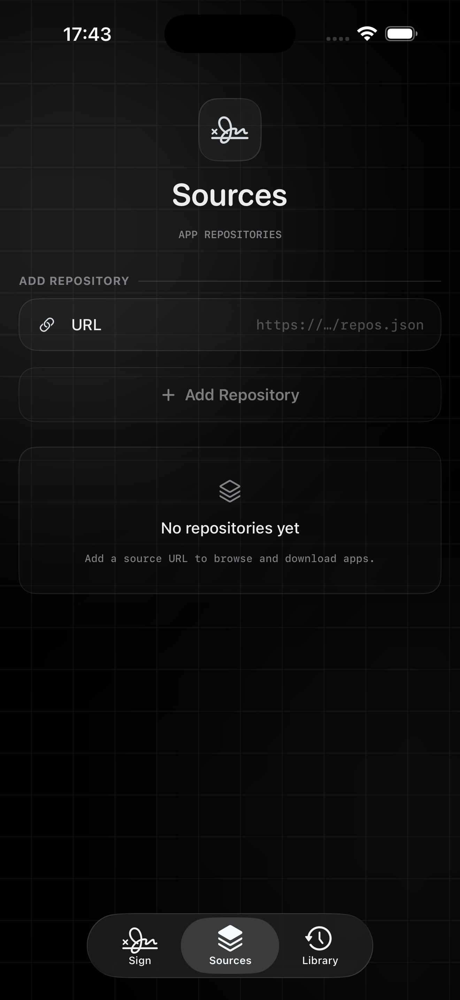
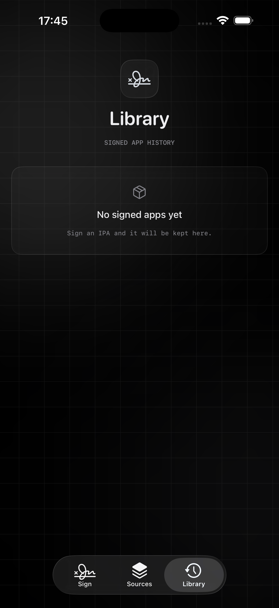

# ForgeSign for iOS

On-device IPA re-signer for iPhone and iPad. Sign and prepare IPAs on-device; installation uses a loopback server and a trusted remote HTTPS manifest, with no certificate or app-content upload.

**[Explore the ForgeSign site](https://mesutcydev.github.io/ForgeSign-iOS/)** · **[Download the latest unsigned IPA](https://github.com/Mesutcydev/ForgeSign-iOS/releases/latest/download/ForgeSign-latest.ipa)**

ForgeSign wraps the battle-tested [zsign](https://github.com/zhlynn/zsign) C++ engine (with a shared OpenSSL 3.5 LTS framework) in a SwiftUI "liquid glass" interface and adds a complete signing workflow on top of it.

<p align="center">
  
  &nbsp;
  
</p>

<p align="center"><sub>Certificate and provisioning identifiers are redacted in the Sign preview.</sub></p>

## Features

- **Sign IPAs on-device** — pick an `.ipa`, a `.p12` certificate and a `.mobileprovision` profile, optionally rewrite the bundle ID, strip app extensions or enable Files sharing, and sign in seconds with the vendored zsign engine.
- **Remembered certificates** — imported `.p12` files are validated once and stored on-device (Application Support). The last-used certificate is re-selected automatically.
- **Certificate insights** — common name, organization and team ID are parsed from the certificate, and a live countdown pill shows remaining validity (`200d left`, amber under 30 days, red when expired).
- **Keychain passwords** — opt-in password storage only in the device-bound iOS Keychain; if Keychain storage is unavailable, ForgeSign asks for the password again.
- **Install on device** — semi-local OTA install: the IPA is served over loopback HTTP while a trusted remote HTTPS plist (`api.palera.in`) drives `itms-services` directly (Safari is a fallback only). The external manifest service receives install metadata and the local package URL.
- **Visible install handoff** — ForgeSign stays on the Result screen, shows when iOS requests and downloads the IPA, and keeps Cancel and Safari fallback available while waiting. iOS controls its own final installation progress and may open the Home Screen after the system prompt.
- **Library** — a persistent history of every signed app with status (signed / installing / delivered / installed / missing), plus reinstall, share and delete actions. Its Storage section shows the space used by signed IPAs, repository downloads, kept originals and the current signing input. You can clear delivered or all signed copies, downloads, originals and the current input separately. Clearing a signed copy keeps its history entry and does not remove the app installed by iOS; sharing or reinstalling that copy requires signing again.
- **Responsive imports** — large IPA/dylib copies and kept originals run off the main thread, with progress and cancellation. A failed or cancelled import preserves the previous input.
- **IPA preflight** — package, bundle, encryption and architecture signals are shown before a signing run.
- **Per-bundle provisioning audit** — the app and every extension show their resolved bundle ID and matching-profile status before signing; only the profiles needed by that IPA are passed to the signer. When you set a new bundle ID that no imported profile covers, the selected profile signs the main app and the audit marks it **selected profile**: certificate, team and device checks still apply, but iOS can refuse to install unless you use a wildcard profile or Apple Account provisioning.
- **Optional Apple Account provisioning** — ForgeSign can create matching profiles for the app, extensions, and File Provider / attachment bundles. Apple sign-in data (anisette) comes from the source you pick: a community anisette server, a server you run yourself, AltServer on your local network, or this iPhone. A remote anisette server means no Mac is required. Manual imported-profile signing remains available.
- **Sources** — save repository feeds and hand selected IPA downloads into the normal signing flow. Downloads enforce a 2 GB limit while streaming, show progress, and can be cancelled. Icons use bounded HTTPS transfers and are downsampled before display.
- **Optional dylib injection** — inject a compatible decrypted dylib into the app, with an opt-in app-extension path, before signing. The original IPA is left untouched.
- **Accessible adaptive design** — clear Liquid Glass cards and controls on iOS 26+, light and dark themes, Dynamic Type, native switches, labeled fields, and solid surfaces for Reduce Transparency and adaptive glass for Increase Contrast.

## Requirements

- Xcode 26+ (the build needs the iOS 26 SDK for the Liquid Glass APIs; deployment target is iOS 16)
- [XcodeGen](https://github.com/yonaskolb/XcodeGen) (`brew install xcodegen`)
- Python 3.12+ and Perl/make (dependency bootstrap)
- iOS 16.0+ on device
- Optional: AltServer on the same local network, or an anisette server. A community anisette server is used by default, so a Mac is not required for Apple Account provisioning.

## Build from source

```bash
python3 scripts/prepare_dependencies.py
xcodegen generate
open ForgeSignMobile.xcodeproj
```

Build the `ForgeSignMobile` scheme for a device. Code signing is disabled in the project settings by design — sign the produced app with your own certificate and profile (ForgeSign desktop can do it, or any sideloading tool).

The bootstrap verifies every source archive against `scripts/dependencies/lock.json`. It builds OpenSSL 3.5.9 from source for iOS arm64 and the host's simulator/macOS architecture, then prepares the pinned authentication-enabled AltSign package locally. Both AltSign and zsign use one embedded OpenSSL framework, with built-in default and legacy providers for modern and older P12 files. Generated dependencies are ignored by Git; rerun the bootstrap after changing the recipe, source pins or Xcode toolchain. No recursive Git clone or scheme-time dependency mutation is required.

The bootstrap applies `vendor/altsign-gsa-http503.patch`, ported from AltSign's `notarized` branch: since October 2026 Apple's GrandSlam only accepts sign-ins whose User-Agent and client info match the client that generated the anisette data, so the patch adds `ALTAppleAPI.authenticationUserAgent` (ForgeSign passes the anisette server's `/v3/client_info` identity; akd's is the default) with the headers current clients send, a fresh connection per authentication request, bounded retries for Apple 5xx responses, safe HTML-response diagnostics, and SMS codes through Apple's current JSON endpoints. Authentication still requires testing with a real account and 2FA. The compatibility patch also checks malformed/incorrect-password P12 imports before accessing their key or certificate.

Package a device build with the checked packaging script (the output must not already exist):

```bash
python3 scripts/package_ipa.py pack /path/to/Release-iphoneos/ForgeSign.app ForgeSign.ipa
python3 scripts/package_ipa.py validate ForgeSign.ipa
```

This excludes Finder metadata and AppleDouble resource forks (`._*`, including misleading `Payload/._ForgeSign.app` entries), preserves executable permissions, and validates the single-app Payload. For an existing IPA, use `repack INPUT.ipa OUTPUT.ipa`; all retained app contents are verified byte-for-byte. Packaging validation does not test Apple authentication or prove installation on a device.

Run the local packaging and native signing regressions with:

```bash
brew install openssl@3
python3 -m unittest discover -s scripts -p 'test_*.py'
bash scripts/test_signer_identity.sh
bash scripts/test_signer_resources.sh
bash scripts/test_crypto.sh
```

The resource test uses host OpenSSL (override its path with
`FORGESIGN_TEST_OPENSSL_ROOT`). The crypto smoke test uses the freshly built
framework and the patched AltSign certificate importer, including modern and
legacy P12s, incorrect passwords, malformed input and CMS signatures.
See [the November 2026 iOS audit](AUDIT_2026-11-08.md) for fixes, validation limits,
and remaining device/account validation.

## Sideload the prebuilt IPA

Grab `ForgeSign-latest.ipa` from [the latest release](https://github.com/Mesutcydev/ForgeSign-iOS/releases/latest). The IPA ships **unsigned** — sign it with your own certificate and provisioning profile before installing.

1. Download the IPA.
2. Sign it with your certificate + provisioning profile — e.g. with ForgeSign (desktop or the iOS app itself), Sideloadly, AltStore or a similar tool.
3. Install the signed IPA on your device.

Only sign and install applications you have the rights to modify. Intended for your own builds and development use.

## Apple Account provisioning

Turn on **Use Apple Account provisioning**, enter the Apple Account credentials and device UDID, and pick an **Anisette source**. When ForgeSign itself is installed by AltStore, its `ALTDeviceID` placeholder is populated automatically. The password is held only for the current run and is sent to Apple by AltSign — never to an anisette server.

| Anisette source | What it does |
|---|---|
| **Automatic** (default) | Tries a community anisette server, then AltServer on your network, then this iPhone. No Mac required. |
| **Remote server** | One community anisette server of your choice, then AltServer and this iPhone as fallbacks. |
| **Custom URL** | An anisette server you run yourself, e.g. `http://YOUR-MAC-LAN-IP:6969`. |
| **This iPhone** | Only this iPhone's own Apple sign-in data. Nothing leaves the device. |
| **AltServer** | Only AltServer on the local network. |

The check button beside the source fetches Apple sign-in data once and reports which source answered, so a broken source is visible before a signing run.

Community servers run the open-source anisette protocol (the same server list SideStore publishes) and only relay the Apple sign-in handshake: they receive a device pseudonym, never your Apple password, certificate, or app contents. You can run your own instead:

```bash
docker run -d --restart always --name anisette-v3 -p 6969:6969 dadoum/anisette-v3-server
```

Enter `http://YOUR-MAC-LAN-IP:6969` as a **Custom URL**. If AltServer is discovered, ForgeSign also tries port 6969 on that Mac automatically.

If Apple Account provisioning cannot finish, ForgeSign checks the imported profiles for manual signing. Each extension or nested app still needs a profile that covers its own bundle ID; a compatible wildcard profile can cover multiple bundles.

ForgeSign reuses a matching imported or previously generated certificate. It deliberately refuses to revoke an unknown existing certificate, because doing so could invalidate AltStore and other installed apps. On a free account already occupied by AltStore, use a separate Apple Account or import the exact matching P12. Normal free-account App ID, active-app and seven-day expiry limits still apply.

## Installation

Signing always ends at a verified `.ipa`. `InstallCoordinator` installs it over
OTA: a loopback HTTP server, a trusted HTTPS manifest and `itms-services`, with
Range requests, a Safari fallback and keep-alive. The Library records
`delivered`, because iOS finishes the install out of process.

### Refresh

Refresh re-uses the signing pipeline instead of reinstalling: the **original
imported package** is kept (opt-in, "Keep originals for refresh", 1.5 GB budget,
oldest evicted first), re-signed with the current certificate and profile, and
installed as an upgrade so app data survives.

- The Library shows each app's real profile expiry (`Expires in 2d 7h`) and a
  readiness pill: `refresh ready` when the original was kept, `refresh due`
  inside the 48-hour window, `action needed` when the original or credentials
  are missing.
- Refresh re-enters the Sign tab with the kept original selected — signing and
  the final IPA verification are never bypassed.
- The expiry comes from the profiles embedded at signing time
  (`profileFiles.notAfter.min()`), so it is what iOS will actually enforce.
- Expiry scanning runs in the foreground. Background execution is **not**
  claimed: a sideloaded app cannot rely on `BGTaskScheduler`, and ForgeSign does
  not pretend otherwise.

## What’s new in 2.8.2

- **Apple Account sign-in with community anisette servers.** Since mid-October 2026 Apple's GrandSlam rejects sign-ins whose client identity doesn't match the anisette server that generated the data (-80045, or an HTML 503). ForgeSign now signs in with the User-Agent and client info the server reports in `/v3/client_info`, and requests SMS codes through Apple's current JSON endpoints (the plist form now fails with HTTP 415). Ported from AltSign's `notarized` branch onto the pinned revision.
- **Refresh installs as an upgrade.** A Library refresh re-signs the kept original with the installed app's bundle ID and original file name, so it replaces the installed app instead of adding a second one.
- **Provisioning no longer leaks a bundle ID.** A bundle ID filled in by Apple Account provisioning is cleared when you pick a different IPA, so the next app can't be signed with the previous app's identity.
- **Packaging.** Apps whose name contains "Payload" (for example `PayloadKit.app`) are packaged with a correct `Payload/` root again, after signing and after dylib injection.
- **Install server.** A file read error during an OTA transfer is reported instead of crashing the app, and a Range header the server can't use is ignored (full download) rather than refused. Returning to ForgeSign mid-download no longer silences the keep-alive, and a server that finished starting after a cancel is stopped.
- **Everyday use.** The chosen certificate is remembered across launches, Keychain password lookups are no longer repeated on every redraw, deleting a certificate or profile asks first, 2FA codes can be filled from Messages, section titles are VoiceOver headings, and the AltServer row stops showing "Searching…" forever.

[Full release notes](WHATS_NEW.md) · [Download the latest IPA](https://github.com/Mesutcydev/ForgeSign-iOS/releases/latest/download/ForgeSign-latest.ipa)

## What’s new in 2.8.1

- Sign, Sources and Library keep their content at a readable width, so an iPad no longer stretches every row across the display and separates a label from its control. iPhone layouts are unchanged.
- Checksum-pinned dependency downloads retry a temporary network failure, and still refuse any archive whose checksum does not match.
- Validated with 79 simulator tests and an iPad pass over both orientations, both appearances and the largest accessibility text size.

[Full release notes](WHATS_NEW.md) · [Download the latest IPA](https://github.com/Mesutcydev/ForgeSign-iOS/releases/latest/download/ForgeSign-latest.ipa)

## What’s new in 2.8

- Reliable OTA connections, partial downloads and cancellation, with install retry and recovery in Library.
- Byte progress and Cancel for repository downloads and background input copies; failed imports preserve the previous selection.
- Stronger preflight/profile checks, encrypted-package blocking, and reliable certificate/profile import sheets.
- Storage controls for signed copies, downloads, kept originals and the current input.
- Clear Liquid Glass, native accessible switches, Dynamic Type and layouts for long names.
- Fixes iOS 27 clean launches and an expiry-check crash on early iOS 27.2 betas.
- One shared OpenSSL 3.5.9 LTS framework for both signing engines, built from checksum-pinned sources.
- Validated with 79 simulator tests and manual signing, verification, OTA installation and launch on a registered iPhone.

[Full release notes](WHATS_NEW.md) · [Download the latest IPA](https://github.com/Mesutcydev/ForgeSign-iOS/releases/latest/download/ForgeSign-latest.ipa)

## What’s new in 2.7

- Removes the paired-device (idevice/LocalDevVPN) install path and its Device Installation card. It was switched on in 2.6 despite the notes below, preempted the working OTA install, and double-freed its session on reuse. Install is OTA-only again.
- Apple Account provisioning only runs when the imported certificate and profiles cannot sign the IPA, so a working manual setup never waits on Apple.
- When only app extensions lack a profile, a **Sign Without App Extensions** button signs the app instead of dead-ending.
- Apple sign-in failures now show Apple's actual response instead of a blanket "HTTP 503".
- ForgeSign no longer claims every `.plist` file in the share sheet.

## What’s new in 2.6

- Adds a **refresh** model: the original imported package can be kept, each Library entry shows its true profile expiry, and refresh re-signs that original and installs it as an upgrade so app data survives.
- Adds the **direct-device transport**: a signed IPA is transferred over the on-device tunnel with `idevice` (vendored, MIT, pinned revision — AFC staging then `installation_proxy`), with install-vs-upgrade decided by the device's own app list, honest progress, and a device-confirmed `installed` state. Off by default until validated on hardware; the OTA flow is unchanged.
- Adds expiry awareness to the Library (`Expires in 2d 7h`, `refresh due` / `action needed` / `refresh ready`) and a header summary of apps expiring within 48 hours.
- No background-refresh claims: the scan runs when the app is in the foreground.
- Each app extension and nested app now requires a profile that covers its own bundle ID. On-device Apple Account provisioning creates these profiles; manual signing accepts a matching wildcard profile or imported per-bundle profiles. The signer and IPA verifier reject an invalid app-profile fallback for extensions.

## What’s new in 2.5

- Adds remote anisette servers, so Apple Account provisioning works without a Mac running AltServer — the same Apple-sign-in path AltStore Classic's no-computer mode uses.
- Adds an **Anisette source** picker with a live check button, so a broken source is visible before signing instead of failing mid-run.
- The Sign button now always explains what is missing; a disabled button no longer silently does nothing.
- Keeps AltServer, this-iPhone, and custom-URL anisette sources, with automatic fallback between them.
- Moves installation behind an `IPAInstallationBackend`/`InstallCoordinator` layer with typed phases and errors, a retry path, and honest Library states. The existing OTA flow is unchanged and remains the only shipped transport.
- Adds device pairing records (Keychain-only), a tunnel probe that reports what actually answers, and a redacted device-install health check with Copy Diagnostics.

## What’s new in 2.4

- Earlier builds attempted to sign extensions with only the app profile. That fallback could produce an IPA rejected during installation and is now rejected before signing.
- Works around the macOS 27 AltServer `machineID` anisette failure by using this iPhone first, then AltServer, then an optional anisette HTTP server.
- Keeps Apple Account provisioning for per-extension and App Group profiles when anisette is available, and falls back to the imported profile when it is not.

## What’s new in 2.3

- Replaces the proposed custom Mac companion with direct discovery and communication with an existing AltServer.
- Adds on-device AltSign authentication, two-factor verification, device registration, safe certificate handling, extension App IDs, shared App Groups and per-bundle profile downloads.
- Preserves manual certificate/profile signing and refuses to revoke an inaccessible AltStore certificate.
- Includes the stable signing header and Home Screen install handoff fixes from 2.2.

## What’s new in 2.2

- Adds a pre-sign profile check for the root app and every extension, with specific bundle ID, team, certificate, device, expiry, and App Group errors.
- Uses only the matching profiles, signs nested bundles before the root app, preserves original identifiers in `ALTBundleID`, and records each resolved profile’s groups in `ALTAppGroups`.
- Adds per-bundle automatic-provisioning hooks; direct AltServer support is completed in 2.3.
- Verifies the final IPA’s signatures, embedded profiles, resolved application identifiers, and `ALTAppGroups` metadata before saving it.
- Keeps the ForgeSign header stable while signing and returns to the Home Screen after handing the install request to iOS.

## What’s new in 2.1

- IPA previews in the iOS Files app now show ForgeSign in the bottom quick-action menu.
- Tapping ForgeSign opens the app with the selected IPA already loaded into the signing workflow.
- IPA registration now uses Apple’s canonical file type while ordinary ZIP archives remain a separate alternate import path.

## What was new in 2.0

- Restores v1.1 behavior: extension-bearing IPAs are no longer rejected by the preflight gate before signing.
- The visible Remove app extensions option remains available, while nested profile matching and final signing validation still fail safely when inputs are incompatible.
- Includes the v1.9 wildcard app-identity fix and certificate/profile picker state fixes.

## What was new in 1.9

- Fixes the Files picker that opened but let you select nothing on sideloaded builds by expanding wildcard application identifiers to concrete bundle IDs.
- Fixes certificate and provisioning-profile picker state across nested sheet dismissal.

## What was new in 1.7

- Uses explicit `UIDocumentPickerMode.import` so sideloaded builds request a local copy instead of opening documents in place.

## What was new in 1.6

- Fixed disabled picker items by using the concrete `public.data` import type instead of abstract `public.item`.
- Declared IPA, dylib, certificate, and provisioning-profile filename UTIs in `Info.plist` for Files provider compatibility.

## What was new in 1.5

- Fixed Files picker selection for sideloaded builds by using an unfiltered import-mode picker instead of dynamic extension UTIs.
- IPA, dylib, certificate, and provisioning-profile extensions are validated after selection, then copied into the app container for reliable processing.

## What was new in 1.4

- Fail-closed IPA extraction with archive limits, structural validation, and mandatory post-sign verification.
- Certificate/profile/team/bundle-ID compatibility gates and CMS-verified provisioning profiles.
- Reliable install delivery accounting, exact HTTP ranges, cancellation, Library state parity, and honest `delivered` status.
- Files/Open In routing, HTTPS repository policy, atomic protected persistence, and Keychain-only password storage.
- 1.3 wildcard iCloud entitlement and Files-picker fix retained.

## What was new in 1.3

- Wildcard and placeholder iCloud entitlements are removed before signing so Files document pickers continue working in installed apps.
- Valid iCloud container entitlements are preserved, while the existing document-browser workaround remains in place.
- 1.2 install reliability, staging cleanup, and Sources feed fixes are included.

## What was new in 1.2

- Install server honours HTTP Range requests, so flaky installs resume instead of restarting.
- Silent-audio keep-alive stops as soon as you return without a download, not only after delivery.
- Staged archives are pruned to the current pick and the signing temp folder is wiped on relaunch.
- Sources feeds use stable row identity (refreshes no longer detach in-flight downloads).
- Wildcard-profile iCloud entitlement stripping extended to kvstore/container-environment leftovers.

## What was new in 1.1

- Preflight card for package, bundle, encryption and architecture checks.
- Optional dylib injection with app-extension support for compatible decrypted Mach-O inputs.
- Sources tab with repository feeds and direct IPA handoff.
- Lighter glass surfaces and refreshed dark-mode screens.



 

## How it works

1. Picked files are staged into the app container.
2. The zsign engine (`Bridge/`) re-signs the Mach-O binaries, injects the profile and rewrites metadata, producing `<name>-signed.ipa` in the persistent Signed library.
3. Install serves the IPA on `http://127.0.0.1:<port>`, obtains a trusted HTTPS `manifest.plist` from `api.palera.in` that points at that IPA, then opens `itms-services://` directly so iOS prompts to install.

## Project layout

```
App/            SwiftUI UI (glass design system in App/Design), stores and services
Bridge/         Obj-C++ bridge into the zsign engine
vendor/zsign    Vendored zsign signing engine
vendor/openssl  Generated shared OpenSSL framework and license
project.yml     XcodeGen manifest (regenerates the .xcodeproj)
```

## Third-party

- [zsign](https://github.com/zhlynn/zsign) — signing engine (vendored)
- [OpenSSL](https://www.openssl.org) — checksum-pinned 3.5 LTS source build
- [AltSign](https://github.com/rileytestut/AltSign) — Apple-account and provisioning API integration (Swift Package, pinned revision)
